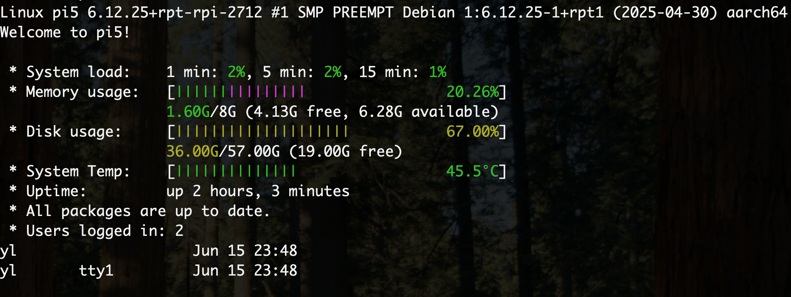

# MOTD

Custom Message Of The Day scripts that display system stats on SSH login.



## Installation

Copy the scripts to `/etc/update-motd.d/` on your SBC:

```bash
sudo cp * /etc/update-motd.d/
sudo chmod +x /etc/update-motd.d/*
```

## Scripts

| File | Purpose |
|------|---------|
| `10-uname` | System info header |
| `20-sysinfo` | CPU load with color-coded bars |
| `21-memusage` | Memory usage |
| `22-diskusage` | Disk usage |
| `23-systemp` | CPU temperature (works on Pi and other SBCs) |
| `24-uptime` | System uptime |
| `25-update` | Available updates |
| `26-user` | Current user info |

The numeric prefix controls display order.

## Platform Support

The temperature script (`23-systemp`) automatically detects the platform:
- **Raspberry Pi**: Uses `vcgencmd measure_temp`
- **Other Linux SBCs**: Falls back to `/sys/class/thermal/thermal_zone0/temp`
